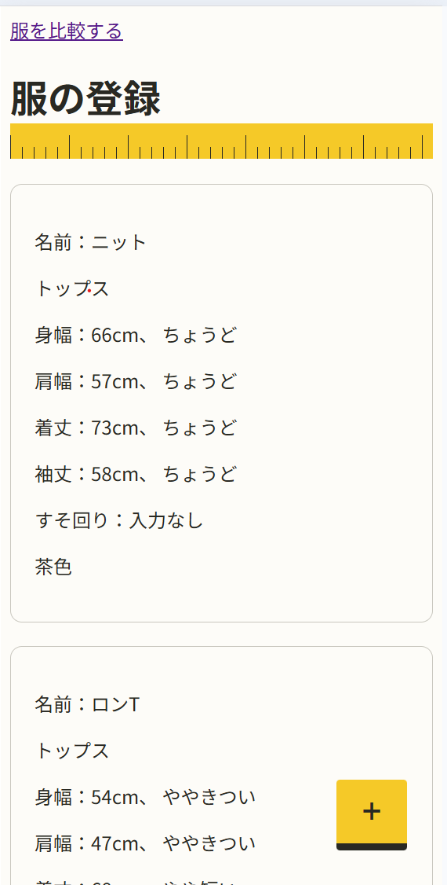
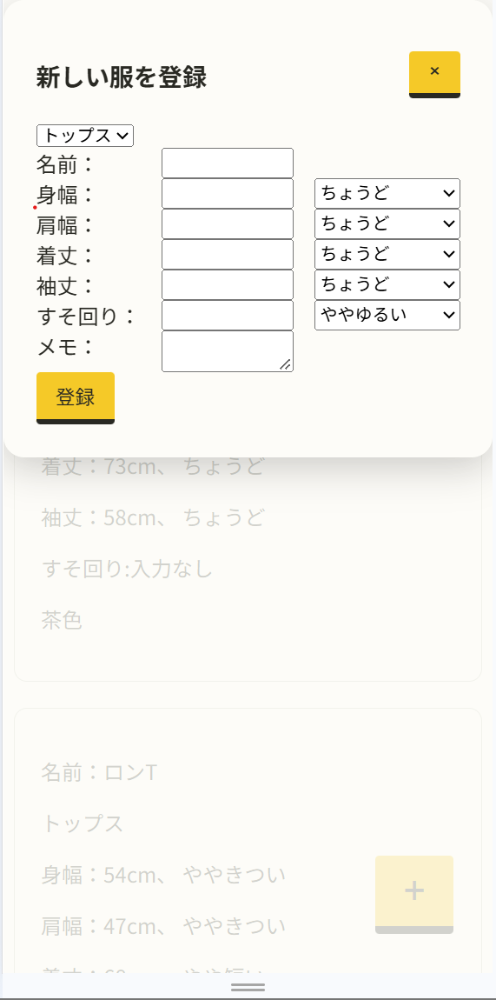
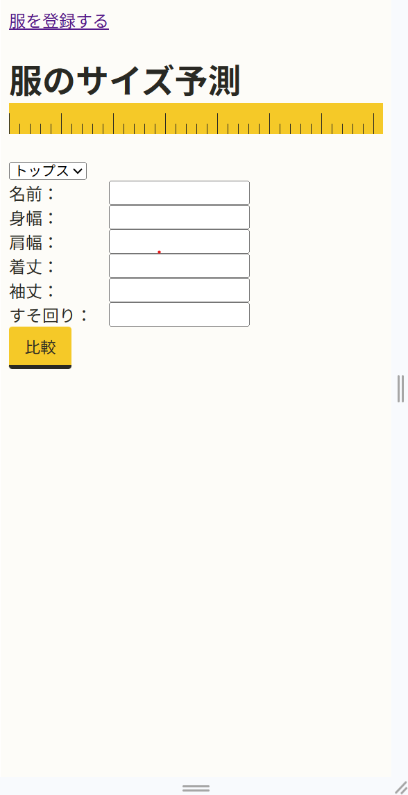

# fit-predictor

JavaScript・HTML・CSSで作った手持ちの服の実寸と着用感をもとに、買う前の服のサイズ感を予測するwebアプリ。

## URL
shugo193.github.io/fit-predictor/
## 使い方

1. 一覧画面の右下の「＋」から持っている服を登録する。カテゴリ（トップス・パンツ）を選び、箇所ごとの実寸（cm）と、着た時の着用感（5段階）を入力する。



2. 比較画面で、買う前の服の実寸（候補の服）を入れて「比較」を押す。手持ちの服の中で、一番実寸が近い2着と並べて表示する。


## 工夫した点
### 近い2着で挟んで表示する。
候補より小さい服の中で一番大きいものと、大きい服の中で一番小さいものの2着を返し、候補をその間に挟んで見せる。
- 1行目に名前、2行目にcm、3行目に着用感を並べ、候補の服の列を真ん中に置く。
- どの服より小さい（大きい）ときは、ない側を「-」にして「さらにきつめ」などを端に出す。
- 同じcmの服があれば「=」で示す。

### nullバグの回避
測っていない箇所は0cmと区別するために`null`で保存している。ところがJavaScriptでは`40>null`は`true`になるので、測っていない服が小さい側に選ばれうる。しかもこのバグは本物の小さい服があると入れ替わって隠れてしまう。最初のテストはこのバグを捕まえることができなかった。`null`を飛ばす処理を消すと失敗する組み合わせでテストをし、テストが本当にバグを捕まえられることも確かめた。

### 終わるのを待たずに進む処理の扱い
indexedDBは読み書きが終わるのを待たずに次の行へ進むので、読んだ結果を`return`で受け取ろうとしたが`return`のほうが先に動き`undefined`になった。
そこで`db.js`の関数は、終わったら呼ぶ関数を受け取る形にした。登録後のトースト表示・モーダルを閉じる処理も、保存し終わってから呼ばれる関数の中に入れ、保存に失敗したのに「登録しました！」と出ないようにした。

### カテゴリや言葉はデータで定義

カテゴリと測る場所（`CATEGORIES`）、着用感の言葉（`EVALUATION`）、予測の言葉（`COMPARE`）をデータとして持ち、画面はそこから作る。箇所ごとに幅か長さかをもたせ、使う言葉を`if`なしで切り替える。

### 巻き尺のデザイン

服のサイズを測るアプリなので、巻き尺をテーマにした。黄色は白い背景の上では見づらいため、背景色として使い、その上に黒い文字を載せた。

## 設計
|ファイル|役割|
|---|---|
|`predict.js`|候補の寸法、手持ちの服の配列・箇所を受け取り実寸が近い2着を返す。画面もDBもいらないのでブラウザなしでテストできる。|
|`db.js`|IndexedDBの処理（開く・全部読む・1着足す）をまとめる。保存先を変えるときはこのファイルを変える。|
|`app.js`|一覧・登録画面|
|`categories.js`|カテゴリ・測る場所・評価の言葉のデータ|
|`compare.js`|比較画面|
|`style.css`|2つの画面の見た目|

服1着分のデータは次の形で保存する。着用感は-2（きつい・短い）~+2（ゆるい・長い）の数値で、測っていない場所は`null`

```js
{
  name: "ニット",
  category: "tops",
  memo: "茶色",
  measurements: {
    bodyWidth: { cmValue: 66, fitEvaluation: 0 },
    hemCircumference: { cmValue: null, fitEvaluation: null },
    // ...
  },
}
```

## テストの動かし方

```
npm test
```
`predict.js`をNode.jsの標準テスト（node:test）で確かめている。

### 確かめていること

- 手持ちが0着なら、小さい側も大きい側も`null`
- 候補が2着に挟まれたら、小さい側と大きい側にそれぞれの服が入る。
- 寸法が`null`の服はとばす。
- 小さい服がないとき、寸法が`null`の服が小さい側に入らない。
- 同じcmの服があれば、小さい側と大きい側の両方にその服が入る。
- どの服よりも小さい（又は大きい）とき、ない側は`null`
- 着用感が矛盾していてもcmの大小で並べる。

## 使用技術
 
- JavaScript（ES Modules）・HTML・CSS
- IndexedDB
- Node.js（`node:test`）
- GitHub Pages

## Future work

- 今は表で事実（名前・cm・着用感）を見せている。コンセプトの「ちょうどよかったAより2cm長いので、少し長めになりそう」のような文まで出す
- 登録した服を直したり消したりできるようにする
- 服の写真を登録できるようにし、一覧のアイコンにする
- 登録のモーダルで背景を押したら閉じる。箱の高さに上限を付け、スマホでキーボードが出ても中をスクロールして登録ボタンまで届くようにする
- 結果の箇所名を目立たせ、箇所ごとに区切り線を入れる
- アウターなどは CATEGORIES にデータを1行足して対応する
- トップス・パンツだけではなく、細かいジャンルにも対応する。
